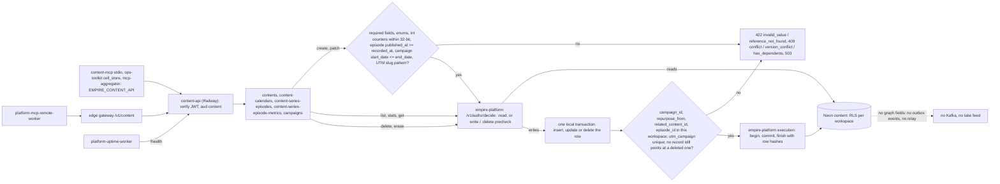

# 01 — Business process (As-Is / To-Be)

life-content-api คือ cell ที่เก็บงาน content ของ owner: ชิ้นงาน content, ปฏิทินการเผยแพร่, ตอนของซีรีส์วิดีโอสั้นกับ snapshot ตัวเลขของแต่ละตอน และแคมเปญการตลาดที่มี `utm_campaign` เป็นกุญแจเชื่อมกับ lead ใน CRM ผู้ใช้คือ owner ผ่าน MCP และเครื่องมือของ owner; ยังไม่มีหน้าเว็บใดอ่าน cell นี้ และ cell ไม่ส่ง event

Last reviewed: 2026-11-27 · commit `65d3163`

## As-Is (จากโค้ดวันนี้)

Sources: `cell.yaml`, `pyproject.toml` (platform-cellkit 1.0.11, entry points), `migrations/0001_content.sql`, `migrations/0002_campaigns.sql`, `README.md`, `PRODUCT.md`, `AGENTS.md`, `docs/cellkit-notes.md`, `specs/003-marketing-campaigns/spec.md`, `tests/test_campaigns.py`, `tests/test_content_defaults.py`; platform-cellkit `v1.0.11` `src/cellkit/app.py`, `server.py`, `gateway.py`; callers: platform-mcp-remote-worker `wrangler.toml`, platform-api-gateway `routes.json` (`content`), platform-uptime-worker `src/targets.ts`

ข้อเท็จจริงสำคัญจากโค้ด:

- ห้า resource ทุกตัวมี list, stats, get, get-by-legacy-id, create (`Idempotency-Key`), patch (`expected_version` ไม่บังคับ เพราะไม่มี field `money`), delete และ `POST /v1/<plural>/erase` (batch 1–500 ค่าเริ่ม 200); list กรองช่วงวันที่ได้ด้วย `<field>_from` / `<field>_to`
- `campaign` (SPEC-003, migration `0002`): `utm_campaign` ต้องไม่ซ้ำใน workspace (409), `utm_*` ต้องตรง `^[a-z0-9][a-z0-9._-]{0,63}$`, `budget_thb` และ `spend_thb` เป็นจำนวนเต็มบาท 0–100000000; `content` และ `content-calendar` ชี้ campaign ผ่าน `campaign_id`
- ตัวนับ (`views`, `shares`, `likes` ฯลฯ) เป็น `int` 32 บิต: ค่าเกินช่วงได้ 422 (`tests/test_content_defaults.py`) แต่ค่าติดลบยังรับได้ ยกเว้น `budget_thb` / `spend_thb`
- id อ้างอิงภายใน cell (`campaign_id`, `repurpose_from`, `related_content_id`, `episode_id`) ตรวจด้วย foreign key ของฐานข้อมูล; `related_niche_id`, `related_project_id`, `related_skill_ids` เป็นตัวเลขหรือข้อความที่ไม่ถูกตรวจ
- `cell.yaml` ไม่มี `graph`: ไม่มี outbox event, ไม่มี relay workflow และไม่มีข้อมูลไป lake
- cell ไม่โพสต์ไปแพลตฟอร์มใดและไม่ดึงตัวเลขเอง: snapshot ของตอนซีรีส์ถูกส่งเข้ามา (`source` ค่าเริ่ม `manual`)
- การ deploy ไม่ migrate ฐานข้อมูลเอง (`AGENTS.md`)
- `content-mcp` (stdio) มี tool `content.<resource>.list|get|create|update|delete` ที่เรียก API ด้วย token ของผู้เรียก (`EMPIRE_MCP_READONLY=1` = อ่านอย่างเดียว)
- ว่า ops-toolkit และ mcp-aggregator เรียกตรงหรือผ่าน gateway, และโหมด `GATEWAY_ASSERTION_MODE` ของ cell อ่านจากโค้ดไม่ได้ [ต้องยืนยัน]

## To-Be (จาก `specs/003-marketing-campaigns/spec.md` และ `PRODUCT.md` §Measures)

ไม่มีแผนภาพ To-Be ของกระบวนการ เอกสารเขียนไว้เพียง:

- SPEC-003 (สถานะในไฟล์ยังเป็น `draft` แม้โค้ดและ migration อยู่ใน `main` แล้ว): CRM เก็บ `utm_campaign` เดียวกันบนทุก inquiry เพื่อ join lead กับ campaign (change คู่ใน sales-crm), owner ให้สิทธิ์ `content.campaign:read|write|delete` บน platform หลัง deploy (ก่อนนั้น route campaign ตอบ 403) แล้วทดสอบ `GET /v1/campaigns` หนึ่งครั้ง
- `PRODUCT.md` §Measures (proposed, ยังไม่มีอะไรเก็บ): calendar entry ที่ถึง `published` หรือ `repurposed` ต่อเดือน, ตอนที่มี snapshot หลังถึง `published_verified`, 5xx และ p95 latency ของ `/v1/contents`

## Gap

| ID | As-Is → To-Be | Status | Owner | Evidence |
|---|---|---|---|---|
| G1 | route campaign อยู่ใน production code แล้ว → owner ให้สิทธิ์ `content.campaign:*` และยืนยัน `GET /v1/campaigns` หลัง deploy (สถานะจริง [ต้องยืนยัน]) | decide | owner | `specs/003-marketing-campaigns/spec.md` §4 Rollout, §5 |
| G2 | ไม่มีการ join lead ของ CRM กับ campaign ใน repo นี้ → CRM เก็บ `utm_campaign` บน inquiry (change คู่ใน sales-crm, สถานะ [ต้องยืนยัน]) | todo | claude | `specs/003-marketing-campaigns/spec.md` Paired change |
| G3 | ไม่มีอะไรเก็บ measures → วัด calendar entry ที่เผยแพร่ต่อเดือน และตอนที่มี snapshot หลัง `published_verified` | todo | claude | `PRODUCT.md` §Measures ("nothing collects them yet") |
| G4 | `PRODUCT.md` ยังไม่มี resource `campaign`, ยังเขียนว่าตัวนับเกินช่วงได้ 500 และ SPEC-003 ยังเป็น `draft` → แก้เอกสารให้ตรงโค้ด | todo | claude | `PRODUCT.md` §Capabilities; `cell.yaml` `campaign`; `tests/test_content_defaults.py` `test_a_counter_above_the_integer_range_is_refused_not_a_server_error` |
| G5 | ไม่มี To-Be ของกระบวนการ content (หน้าเว็บที่อ่าน cell, event, การดึงตัวเลขจากแพลตฟอร์ม) → owner กำหนด | decide | owner | ไม่มีใน `PRODUCT.md` / `specs/` (`PRODUCT.md`: "No web page reads this cell yet") |

## Open questions

- `related_niche_id`, `related_project_id`, `related_skill_ids` ชี้ไป cell ใด (`PRODUCT.md` ระบุ [ต้องยืนยัน])
- ควรห้ามตัวนับติดลบหรือไม่ (`PRODUCT.md` บอกว่ารับค่าติดลบได้)
